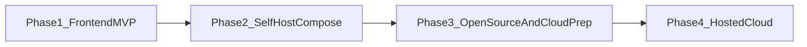

# Product Roadmap

exam.one ships in four phases: a completed frontend-only German MVP, a localhost Docker Compose full stack, a public open-source release with community docs, and a hosted cloud product. Orientation (not a 1:1 copy): successful self-host → community → cloud patterns such as [Postiz](https://github.com/gitroomhq/postiz-app).

---

## Phase 1: Frontend-Only MVP (complete)

The first usable, shippable version is **frontend only** for product flows — practice data does not require NestJS or PostgreSQL yet. The app is built in Nuxt/Vue, with thin Nuxt server routes proxying the user's LLM provider (bring-your-own-key). All user data (drafts, attempts, results) lives in localStorage. Core practice flows are **offline-capable** and do not require the network; AI is optional.

> **Note:** NestJS / Prisma / Compose are in the repo. **Phase 2.1–2.6 are complete** (API + login-gated accounts + practice persistence + NestJS AI/TTS/STT proxy + Compose packaging + self-host runbook). **Current is 2.7–2.11** (auth/settings UI fidelity, security, design comparison, exam-pack framework). Phase 3 follows.

The German / Goethe A2 product is complete and tested across Reading, Writing, Listening, Speaking, and mock exam mode. Goethe A2 remains the first complete exam product; the generic exam-pack contract (language, level, board, prompts, seed shapes) is the 2.11 gate before public open-source release.

### Skill status (Goethe A2)

| Skill     | Status                  | Notes                                                                                                                 |
| --------- | ----------------------- | --------------------------------------------------------------------------------------------------------------------- |
| Reading   | **Complete and tested** | Seed content, practice, scoring, explanations, progress, and optional AI generation                                   |
| Writing   | **Complete and tested** | Seed content, drafts, optional AI grading, persisted detailed reviews, and generation                                 |
| Listening | **Complete and tested** | Four exam parts, automatic scoring, stable WAVs, replay rules, and optional Docker TTS                                |
| Speaking  | **Complete and tested** | Recording, local/cloud STT or manual transcripts, optional AI grading, persisted reviews, and local attempts          |
| Mock exam | **Complete and tested** | Offline Set 1, generated local sets, resumable pipeline, automatic grading, module reviews, and aggregate AI overview |

### Substages

#### 1.1 Goethe A2 core skills

**Complete and tested:** Reading, Writing, Listening, and Speaking provide local-first practice against the product's modular Goethe A2 rules.

- Reading provides exam-style content, scored questions, explanations, progress, and optional generation.
- Writing provides drafts, word-count rules, optional automatic AI grading, detailed feedback, and persisted results.
- Listening provides all four exam parts, stable seed audio, official replay behavior in mock exams, and optional Docker TTS generation.
- Speaking provides recording, provider-neutral local/cloud STT, editable/manual transcripts, automatic optional AI grading, detailed feedback, and persisted attempts.
- Every core skill remains usable without a cloud AI provider; optional enhancements fail gracefully.

#### 1.2 Mock exam mode

**Complete and tested:** Goethe A2 Set 1 ships as a local-first simulation with reload-safe timers, ordered and locked exercises, immutable answer snapshots, and module scoring. It remains usable without an LLM or TTS service.

Users can generate additional immutable sets after preflight verifies the LLM configuration, provider connection, and Docker TTS health. Reading, Listening content/audio, Writing, and Speaking run serially through a persisted, resumable pipeline with expandable module progress. Completed attempts provide automatic scores, read-only exercise review pages, persisted Writing/Speaking AI review details, and an optional aggregate AI overview in the active UI language.

#### 1.3 Demo prompt templates + BYOK AI

Bundled editable prompt templates for generate / review / grade. Supported providers: **OpenAI** and **OpenRouter**. Graceful degrade when keys are missing or upstream AI fails. Root `.env` is loaded by Nest (`../../.env`) and by Nuxt via `--dotenv ../../.env`.

#### 1.4 Polish / ship gate

i18n, settings, and progress UX solid enough that Phase 2 can freeze the product surface and migrate persistence without redesigning core practice flows.

**Exit criteria: met.** German / Goethe A2 Reading, Writing, Listening, Speaking, mock exam mode, local persistence, and optional BYOK AI work end-to-end in the frontend-only architecture. Phase 1 is complete.

---

## Phase 2: Self-Hostable Full-Stack App (current)

**2.1–2.6 are complete.** Remaining work is 2.7–2.11 before Phase 3.

Evolve the finished frontend MVP into a full-stack application that users run on their own laptop via **Docker Compose** (Nuxt frontend, NestJS backend, PostgreSQL). A self-hosted instance supports **multi-user registration** (email + password; no seeded operator). AI features still use the user's own LLM API keys (OpenAI / OpenRouter).

**Stack:**

- **Frontend** — Vue.js (Nuxt)
- **Backend** — NestJS API owning auth, practice persistence, and the LLM/TTS/STT proxy
- **Database** — PostgreSQL for users, exercises, attempts, results, drafts, and settings
- **Persistence** — accounts, session, profile, exam settings, skill catalogs, attempts, drafts, generation jobs, and mock exams are API-backed. Theme, locale, and playback prefs remain client-side.
- **Packaging** — single-command Docker Compose self-hosting with a **named Postgres volume** so data survives container removal/recreation

### Substages

#### 2.1 Backend foundation

**Complete:** NestJS API modules, shared `@exam-one/contracts`, Prisma schema for users / auth tokens / exercises / attempts / results / drafts / settings, health checks, and Compose/Postgres wiring.

#### 2.2 Auth and account UI

**Complete and tested:** Scalo-derived login, register, forgot/reset password, verify, profile, and settings screens are wired to NestJS. The app shell is login-gated.

- JWT httpOnly cookies (`exam_one_access` / `exam_one_refresh`), bcrypt passwords, and global JWT guard with public auth/health routes.
- Multi-user registration with no seeded operator account. Email is the login identifier; SMTP is off by default (`EMAIL_PROVIDER=none`) and optional for verify/reset mail.
- Local lockout recovery via `pnpm auth:set-password`. 2FA and Google OAuth were skipped. Billing stays demo.
- Nuxt auth layout/pages, global middleware, and account/settings API hydration. Gated app routes are client-only (`ssr: false`); `/auth/**` remains SSR'd.

#### 2.3 Persistence cutover

**Complete:** skill catalogs, attempts, drafts, generation jobs, and mock exams are NestJS/PostgreSQL-backed after login. Shared Goethe A2 seeds (and bundled mock Set 1) are upserted by Prisma `db:seed` from `@exam-one/exam-content`. Theme, locale, listening playback, and reading bookmarks stay client-side. Prompt templates stay out of this slice.

#### 2.4 AI move to NestJS

**Complete:** Nitro is no longer the AI/TTS/STT proxy. NestJS owns OpenAI and OpenRouter adapters plus Kokoro TTS and Parakeet/Whisper STT behind `{ data, error }` envelopes. Instance-level BYOK keys stay in env. Generated listening WAVs are written by Nest onto the shared `generated_listening_audio` volume and still served from the Nuxt origin. Graceful degrade is unchanged.

#### 2.5 Docker Compose packaging

**Complete:** one root `compose.yaml` for frontend, backend, Postgres, Kokoro TTS, and Parakeet STT. `pnpm stack:up` downloads host-persisted speech models, waits on the core app (Postgres + Nest migrate/seed + Nuxt), then starts speech sidecars. Named volumes preserve Postgres data and generated listening audio; host directories preserve speech weights and seed `a2/` WAVs. Local Parakeet uses the sub-1 GB Handy Q8 GGUF with a pinned `transcribe.cpp` runtime. Local development selects only the root file's `postgres` service.

#### 2.6 Self-host runbook

**Complete:** root README + `.env.example` cover Docker/Compose install, `pnpm stack:up`, first-user registration, optional LLM keys, speech sidecars, named-volume backup/restore, upgrades, and troubleshooting. Full documentation site waits for Phase 3.

**2.1–2.6 exit: met.** All Phase 1 practice flows work against the DB-backed stack on localhost Docker Compose with durable volume data. Auth and account screens are functional (not yet design-faithful). Practice data and prompts remain Goethe-shaped until 2.11.

#### 2.7 Auth UI fidelity

**Current.** Close the gap between `exam-one-design/project/auth.jsx` and `apps/frontend/pages/auth/*` plus the auth layout and shared auth components.

- Match the designed screens: login, register, forgot, sent, reset, reset-done, verify, welcome.
- Shared chrome: split-card shell, field icons, blur validation, password show/hide, strength meter with labels, AuthAside readiness card.
- Do **not** add Google OAuth (skipped in 2.2). A visual Google button, if present, stays disabled / self-host-unavailable.
- Keep remember-me, lockout messaging, and copy aligned with the design without changing the NestJS auth contract unless a screen cannot be honest otherwise.

#### 2.8 Account, profile, and settings UI

Implement the designed settings shell and account surface from `exam-one-design/project/settings.jsx`, `settings-prefs.jsx`, and Account in `exercise-interior.jsx`.

- Settings left nav and sections: Profile, Security, Plan & billing (demo), Learning plan, AI provider (instance status / test connection), Notifications, Appearance, Your data.
- Wire existing Nest APIs. Cloud-only features (paid billing, Google connected accounts, push) stay demo or disabled.
- Instance-level BYOK keys stay in env (2.4); the AI provider panel must not store per-user API keys.
- Practice interiors, mock exam, dashboard, and progress stay out of this slice (2.10). Learning-plan exam-board/level UI may stay Goethe-scoped until 2.11.

#### 2.9 Security analysis and fixes

Agent-led review of the self-hosted stack, then fix confirmed issues in this stage.

- NestJS auth: JWT httpOnly cookies, reset/verify tokens, lockout, session handling.
- Input validation, injection, secrets in env, Compose exposure, frontend XSS.
- Document residual risk that is accepted rather than fixed. This is not a pentest of third-party hosts.

#### 2.10 Design-vs-implementation comparison

Screen-by-screen compare `exam-one-design/project` (dashboard, shell, exercises, interiors, mock exam, progress, gen-queue, leftover auth/settings) to the Nuxt app.

- Deliverable: a written punch list under `agent-os/product/` for later fixing.
- This stage finds and plans inconsistencies; it does not implement the full visual backlog.

#### 2.11 Generic exam-pack framework

Last Phase 2 gate before public open-source release. Define an explicit exam-pack contract so a forker or future cloud catalog can add any language exam without editing Goethe-hardcoded modules.

- Typed pack identity: language, CEFR level, exam board / format id.
- Structure: modules, parts, timings, scoring.
- Prompt kinds per skill/part: generator, model answer, review/grade, plus the JSON output contracts the LLM must satisfy.
- Seed/exercise payload shapes registered against those contracts.
- LLM/TTS/STT roles a pack may declare (still BYOK / instance env; packs do not embed API keys).
- Move the live Goethe A2 product (and existing Goethe C1 writing prompts) onto a pack registry resolved by pack id. Replace the single `apps/frontend/data/examStructure/goetheA2.ts` plus `Difficulty = 'A2' | 'C1'` assumption.
- Contributor flow: required files, prompt kinds, validation, seed upsert, and what the app will and will not do without a pack. First home: `agent-os/product/` plus a README pointer. Phase 3.3 publishes that guide in Docusaurus.
- Demo A1 prompt + structure packs for **English, German, and Spanish** as proof the interface works — not three full A1 products (no complete seed catalogs, listening WAV libraries, or mock-exam sets at A1). Goethe A2 remains the only complete and tested exam product at the end of 2.11.

**Phase 2 exit:** 2.1–2.6 still met; 2.7–2.8 UI matches the designed auth/account/settings surface; 2.9 findings fixed or documented; 2.10 punch list exists; 2.11 exam-pack interfaces, Goethe A2 migrated, contributor flow written, and A1 demo packs for en/de/es present. Then Phase 3.

---

## Phase 3: Open-Source Release, Community, and Cloud Prep

Make the self-hosted solution public, document it properly, grow with community feedback, add open-source product enhancements, and prepare (but not yet ship) the hosted cloud product.

### Substages

#### 3.1 Public GitHub release

License, CONTRIBUTING, issue/PR templates, security policy, changelog. Publish the repository for external use.

#### 3.2 Community loop

Triage issues and pull requests, accept external contributions under project standards, and track user feedback.

#### 3.3 Docusaurus docs site

Dedicated docs project ([Docusaurus](https://docusaurus.io/)): install/self-host, architecture, AI provider setup, troubleshooting; version docs as needed. The exam-framework extension guide **publishes the 2.11 contract and contributor flow**; it does not invent them.

#### 3.4 Open-source product enhancements

Progress history per skill, exam-readiness score over time, and adaptive practice that surfaces exercises targeting weak areas.

#### 3.5 Cloud groundwork

Multi-tenant design notes, auth hardening, billing research, and deploy topology — without shipping the paid hosted product yet.

**Exit criteria:** public repo with working self-host docs site, active issue/PR workflow, and a written path to cloud hosting.

---

## Phase 4: Hosted Cloud Product

A separately hosted copy of the project, run in the cloud and offered under paid price plans for users who prefer not to self-host.

### Substages

#### 4.1 Managed hosting

Managed accounts, cloud sync across devices, and paid plans.

#### 4.2 Exam expansion

More packs **on the 2.11 exam-pack interfaces**: further Goethe levels beyond A2, plus additional language certifications and difficulty levels. This stage does not define the framework.

#### 4.3 Collaboration features

Teacher / classroom / cohort mode as a later cloud differentiator.
