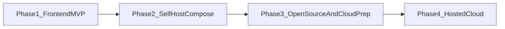

# Product Roadmap

exam.one ships in four phases: finish a frontend-only German MVP, then a localhost Docker Compose full stack, then a public open-source release with community docs, then a hosted cloud product. Orientation (not a 1:1 copy): successful self-host → community → cloud patterns such as [Postiz](https://github.com/gitroomhq/postiz-app).

---

## Phase 1: Frontend-Only MVP (current)

The first usable, shippable version is **frontend only** — no separate backend and no database. The app is built in Nuxt/Vue, with thin Nuxt server routes proxying the user's LLM provider (bring-your-own-key). All user data (drafts, attempts, results) lives in localStorage. Core practice flows are **offline-capable** and do not require the network; AI is optional.

**Supported exams in this phase:**
- **German / Goethe A2** — full skills (Reading, Writing, Listening, Speaking) + mock exam (see `german-exam-A2.md`)
- **German / Goethe C1** — **Writing only** (partial; see `german-exam-C1.md`)

English / Cambridge and other providers are out of scope for Phase 1.

### Skill status (Goethe A2)

| Skill | Status | Notes |
|-------|--------|--------|
| Reading | Done (iteration 1) | Seed + practice + optional AI generate |
| Writing | Done (iteration 1) | Seed + drafts + optional AI generate / review |
| Listening | **Done (iteration 1)** | 4 Teile, MCQ scoring, seed WAVs + on-demand Kokoro TTS, missing-audio lock UX |
| Speaking | **Next** | Scaffold for Teil 1–2 only; STT/review/Teil 3 still open — see substages below |
| Mock exam | Not started | Depends on all four skills being practice-ready |

### Substages

#### 1.1 Goethe A2 core skills

Finish Reading, Writing, Listening, and Speaking practice against modular Goethe A2 rules.

**Listening (complete — iteration 1):**
- Teile 1–4 practice sessions with Goethe replay limits and shared/per-item players
- Pre-generated seed audio (Kokoro German Martin) via `pnpm generate:listening-audio` / `scripts/tts/README.md`
- In-app **Generate audio** when TTS is up; answers/playback locked until files exist
- Optional AI listening generation (transcripts); audio remains a separate generation step

**Speaking (in progress — next focus):**

Complete Goethe A2 `Sprechen` so offline practice works without AI, with optional STT/TTS + review when keys/services are available. See `german-exam-A2.md` (Speaking) for exam rules (4 + 8 + 8 + 5 pronunciation = 25, no ×1.25).

Ordered plan:

1. **Harden Teil 1–2 offline practice** — expand seeds, part-specific UX (cards / keywords / timer), attempt history, no dependency on AI.
2. **Wire real AI review** — speaking review endpoint + composable; replace mock rubrics; store criteria points in progress (Teil 2 first, then Teil 1).
3. **STT pipeline (graceful degrade)** — transcribe recordings for review; allow manual transcript / submit-without-AI when STT is unavailable.
4. **Teil 1 dialogue structure** — turn-based ask/answer flow and chat log suitable for review (TTS partner can come later).
5. **Teil 3 joint planning** — `userSchedule` / `aiSchedule` with guaranteed overlap, propose/decline/agree UI, review of full dialogue log.
6. **Optional TTS partner + pronunciation score** — reuse listening TTS stack for partner lines; separate 0–5 Aussprache when AI is available.
7. **Mock-exam speaking module** — 15-minute module timer and 25-point total, aligned with mock exam shell (substage 1.2).

**Speaking Phase 1 “done” cut:** steps 1–3 deliver usable scored Teil 1–2 practice offline + optional AI. Steps 4–5 close Goethe coverage; 6–7 polish into mock exam.

#### 1.2 Mock exam mode

Single-attempt, timed simulation with the same limitations applied in real language exams (no pauses that break exam realism). Start after Speaking practice is usable (at least Teil 1–2 scored).

#### 1.3 Goethe C1 writing (partial)

Writing practice plus review/generation prompt templates only. No full C1 Reading, Listening, Speaking, or C1 mock exam in this phase.

#### 1.4 Demo prompt templates + BYOK AI

Bundled editable prompt templates for generate / review / grade. Supported providers: **OpenAI** and **OpenRouter**. Graceful degrade when keys are missing or upstream AI fails. Root `.env` is loaded by Nest (`../../.env`) and by Nuxt via `--dotenv ../../.env`.

#### 1.5 Polish / ship gate

i18n, settings, and progress UX solid enough that Phase 2 can freeze the product surface and migrate persistence without redesigning core practice flows.

**Exit criteria:** Goethe A2 all skills + mock exam, Goethe C1 writing, and BYOK AI work end-to-end in the frontend-only architecture.

---

## Phase 2: Self-Hostable Full-Stack App (localhost first)

Evolve the finished frontend MVP into a full-stack application that users run on their own laptop via **Docker Compose** (Nuxt frontend, NestJS backend, PostgreSQL). Like Postiz / n8n, a self-hosted instance supports signing up a single operator who then uses the app. AI features still use the user's own LLM API keys (OpenAI / OpenRouter).

**Stack:**
- **Frontend** — Vue.js (Nuxt)
- **Backend** — NestJS API replacing the thin Nuxt AI proxy for long-term ownership
- **Database** — PostgreSQL for users, exercises, attempts, results, drafts, and settings
- **Persistence** — localStorage for exam/user data fully replaced by API-backed state
- **Packaging** — single-command Docker Compose self-hosting with a **named Postgres volume** so data survives container removal/recreation

### Substages

#### 2.1 Backend foundation

NestJS API modules, shared contracts, Prisma schema for users / exercises / attempts / results / drafts / settings, and health checks.

#### 2.2 Auth and account UI

Wire Scalo-derived auth, profile, and settings pages (login, register, forgot/reset password, verify account, 2FA as applicable, profile/account settings) to NestJS auth. Vue/Nuxt is retained partly to reuse this UI library.

#### 2.3 Persistence cutover

Replace skill, mock exam, progress, and draft localStorage with NestJS API + PostgreSQL. Optional one-time client migration helper. Seed content moves to a DB- or server-owned seed strategy. Theme and similar non-authoritative UI prefs may remain client-side.

#### 2.4 AI move to NestJS

Retire Nitro as the long-term AI proxy. OpenAI and OpenRouter adapters behind the same `{ data, error }` envelope; graceful degrade unchanged.

#### 2.5 Docker Compose packaging

Production compose for frontend, backend, and Postgres. Named volume for Postgres data (removing containers must not wipe user data). Env templates for LLM keys. `compose.dev.yaml` remains Postgres-for-local-development.

#### 2.6 Self-host runbook

Root README + env reference: install Docker, `compose up`, first user, configure API keys, backup/restore the named volume. Full documentation site waits for Phase 3.

**Exit criteria:** all Phase 1 practice flows work against the DB-backed stack on localhost Docker Compose with durable volume data.

---

## Phase 3: Open-Source Release, Community, and Cloud Prep

Make the self-hosted solution public, document it properly, grow with community feedback, add open-source product enhancements, and prepare (but not yet ship) the hosted cloud product.

### Substages

#### 3.1 Public GitHub release

License, CONTRIBUTING, issue/PR templates, security policy, changelog. Publish the repository for external use.

#### 3.2 Community loop

Triage issues and pull requests, accept external contributions under project standards, and track user feedback.

#### 3.3 Docusaurus docs site

Dedicated docs project ([Docusaurus](https://docusaurus.io/)): install/self-host, architecture, exam-framework extension guide, AI provider setup, troubleshooting; version docs as needed.

#### 3.4 Open-source product enhancements

Progress history per skill, exam-readiness score over time, and adaptive practice that surfaces exercises targeting weak areas.

#### 3.5 Cloud groundwork

Multi-tenant design notes, auth hardening, billing research, and deploy topology — without shipping the paid hosted product yet.

**Exit criteria:** public repo with working self-host docs site, active issue/PR workflow, and a written path to cloud hosting.

---

## Phase 4: Hosted Cloud Product

A separately hosted copy of the project, run in the cloud and offered under paid price plans for users who prefer not to self-host.

### Substages

#### 4.1 Managed hosting

Managed accounts, cloud sync across devices, and paid plans.

#### 4.2 Exam expansion

More Goethe levels beyond A2 and C1-writing; additional language certifications and difficulty levels via the generic framework.

#### 4.3 Collaboration features

Teacher / classroom / cohort mode as a later cloud differentiator.
